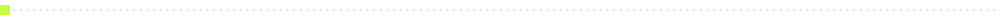
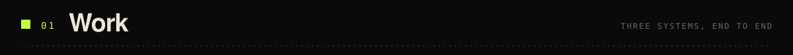
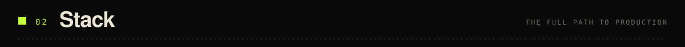
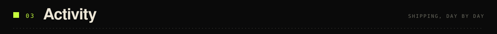
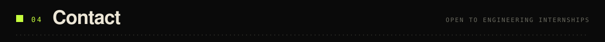

<p align="center">
  
</p>

<p align="center">
  <a href="https://vineet-sahoo.netlify.app/"><b>PORTFOLIO</b></a> &nbsp;/&nbsp;
  <a href="#work"><b>WORK</b></a> &nbsp;/&nbsp;
  <a href="#stack"><b>STACK</b></a> &nbsp;/&nbsp;
  <a href="#activity"><b>ACTIVITY</b></a> &nbsp;/&nbsp;
  <a href="#contact"><b>CONTACT</b></a>
</p>

<p align="center">
  
  &nbsp;
  
  &nbsp;
  
</p>

<p align="center"></p>

```typescript
const vineet = {
  role     : "Full-stack & DevOps engineer",
  base     : "Chennai, IST",
  domains  : [
    "Scalable Frontend Engineering",
    "AI-Powered Full-Stack Systems",
    "Cloud Infrastructure & DevOps",
  ],
  openTo   : ["Engineering Internships", "Technical Collaborations", "Open Source"],
};
```

> I build software that is technically sound, visually precise, and architecturally intentional.

I work across three layers that usually belong to different people: the interface, the AI behind it, and the infrastructure it ships on. Mora AI is the clearest example. A React dashboard on top, a Bedrock → Ollama → local model fallback chain in the middle, Terraform and EKS underneath.

<p align="center"></p>

<a id="work"></a>


<br/>

<!-- ═══════════════ PROJECT 01 ═══════════════ -->

<table>
<tr>
<td width="53%" valign="top">

**[Mora AI: AI-Driven CI/CD RCA Platform](https://github.com/Vineetsahoo/AI-Driven-CI-CD-RCA-Dashboard)**

&ensp;&ensp;

`DEVOPS` `AI / ML` `SAAS` `CLOUD`

Finds CI/CD pipeline failures, writes the root-cause analysis, and offers one-click remediation.

- **No single point of failure.** The AI layer falls back from AWS Bedrock Nova to Ollama to a local model.
- **Everything is code.** Terraform defines the VPC, EKS, ECR, Lambda, CloudWatch, and Bedrock IAM.
- **One command to ship.** Ansible, Terraform, and kubectl roll it out to EKS.
- **Observable by default.** Grafana dashboards are provisioned from the backend's live `/metrics`.
- **Gated CI.** `backend-check → frontend-build → api-smoke → sonar-scan → docker-build`


**[Read the repo →](https://github.com/Vineetsahoo/AI-Driven-CI-CD-RCA-Dashboard)**

</td>
<td width="47%" valign="middle" align="center">


<br/><br/>


</td>
</tr>
</table>

<p align="center"></p>

<!-- ═══════════════ PROJECT 02 ═══════════════ -->

<table>
<tr>
<td width="47%" valign="middle" align="center">


<br/><br/>


</td>
<td width="53%" valign="top">

**[GhostCred: Secret Leak Detector + Auto-Revoker for AI Dev Toolchains](https://github.com/Vineetsahoo/GhostCred)**

&ensp;&ensp;

`SECURITY` `DEVOPS` `AI TOOLCHAIN` `PYTHON`

Finds leaked secrets where AI coding agents leave them, then revokes them at the provider.

- **Scans the blind spots.** `claude_desktop_config.json`, `.cursor/mcp.json`, `.vscode/settings.json`, and shell history, which Gitleaks, TruffleHog, and detect-secrets don't cover.
- **Maps the blast radius.** A lineage graph follows a secret from origin file to Docker build log, CI log, test artifact, and git history.
- **Acts, not just alerts.** Once a secret is confirmed live, webhooks call the revocation API at GitHub, OpenAI, or Anthropic.
- **Guards every gate.** Pre-commit hook, GitHub Actions PR blocker, Docker pre-build guard, and a Prometheus and Grafana stack.
- **Tested.** 144 tests across 5 modules.


**[Read the repo →](https://github.com/Vineetsahoo/GhostCred)**

</td>
</tr>
</table>

<p align="center"></p>

<!-- ═══════════════ PROJECT 03 ═══════════════ -->

<table>
<tr>
<td width="53%" valign="top">

**[CardioVision AI: Healthcare ML System](https://github.com/Vineetsahoo/CardioVision-AI)**

&ensp;&ensp;

`MACHINE LEARNING` `HEALTHCARE` `DATA SCIENCE` `PYTHON`

Turns patient diagnostic data into cardiovascular risk predictions.

- **Full pipeline.** Ingestion, EDA, feature engineering, training, and evaluation.
- **Compared, not assumed.** Several classifiers with cross-validation and hyperparameter tuning.
- **Readable results.** Visualizations of feature correlations and risk distributions.


**[Read the repo →](https://github.com/Vineetsahoo/CardioVision-AI)**

</td>
<td width="47%" valign="middle" align="center">


<br/><br/>


</td>
</tr>
</table>

<p align="center"></p>

<a id="stack"></a>


<br/>

<div align="center">

<table width="100%">
<tr>
<th align="center" width="37%">Frontend</th>
<th align="center" width="30%">Backend</th>
<th align="center" width="33%">Databases</th>
</tr>
<tr>
<td align="center">


</td>
<td align="center">


</td>
<td align="center">


</td>
</tr>
<tr>
<th align="center">Cloud & DevOps</th>
<th align="center">Languages</th>
<th align="center">Security & Observability</th>
</tr>
<tr>
<td align="center">


</td>
<td align="center">


</td>
<td align="center">


</td>
</tr>
</table>

</div>

<p align="center"></p>

<a id="activity"></a>


<br/>

<p align="center">
  
</p>

<p align="center"></p>

<a id="contact"></a>


<br/>

<div align="center">

Open to **engineering internships**, **technical collaborations**, and **impactful open source work**.
Building something serious in AI, cloud infrastructure, or modern web engineering? Reach out.

<br/>

<p align="center">
<a href="https://www.linkedin.com/in/vineet-sahoo-81b022311/"></a>&ensp;
<a href="https://vineet-sahoo.netlify.app/"></a>&ensp;
<a href="mailto:vineetsahoo3@gmail.com"></a>&ensp;
<a href="https://x.com/VineetSaho63046"></a>
</p>

<br/>


</div>

<p align="center">
  
</p>
